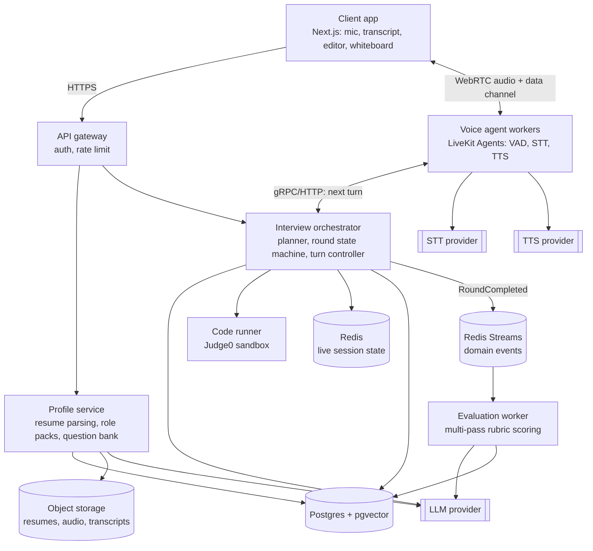
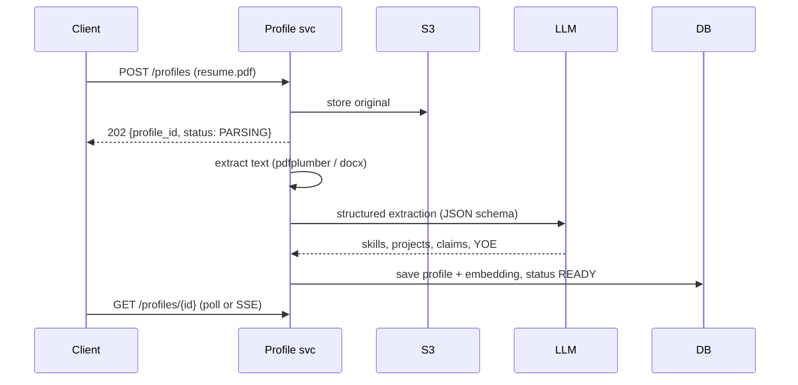
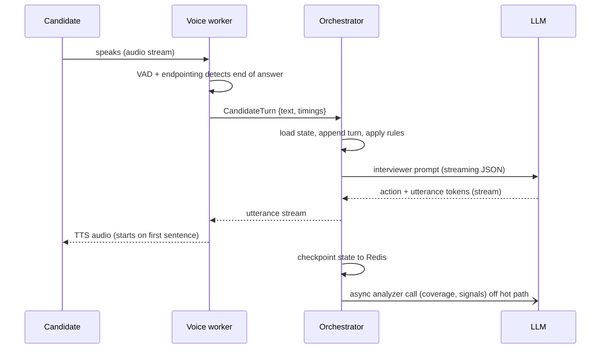

# 02 — High-Level Design

## Component diagram

## Responsibilities
| Component | Owns | Does NOT own |
|-----------|------|--------------|
| Client | UI, mic capture, playback, editor, whiteboard, transcript display | Any interview logic |
| Gateway | JWT auth, rate limiting, routing | Business logic |
| Profile service | Resume upload & parsing, candidate profile, role packs, question bank | Live sessions |
| Orchestrator | Session plan, round state machine, turn decisions, coverage tracking, checkpoints | Audio, scoring |
| Voice worker | VAD/endpointing, STT, TTS, barge-in, audio streaming | What to ask next |
| Eval worker | Rubric scoring, evidence validation, report generation, weak-topic updates | Live interaction |
| Code runner | Sandboxed compile/run with limits | Judging code quality (eval does that) |

## Key flows

### 1. Resume upload

### 2. Start session and plan
1. `POST /sessions` with profile, role pack, level, mode.
2. Orchestrator `InterviewPlanner` loads role pack → rounds for level → per-round topic plan
   (mix of role-pack mandatory topics + resume-driven topics + user's past weak topics).
3. Plan saved to Postgres, live state initialized in Redis.
4. Voice mode: orchestrator asks LiveKit to create a room and dispatch a voice worker; returns a client token.

### 3. One live turn (voice) — the hot path

### 4. Round end → evaluation
1. Turn controller emits `end_round` (or time budget reached).
2. Orchestrator persists transcript, marks round `EVALUATING`, publishes `RoundCompleted` to Redis Stream.
3. Next round starts immediately (eval is not on the critical path).
4. Eval worker scores round (3 passes), writes `round_scores`.
5. After last round: `SessionCompleted` → report generation → user notified.

## Failure handling
| Failure | Handling |
|---------|----------|
| Voice worker crash | State checkpointed per turn; LiveKit re-dispatches worker; it reloads state from Redis and resumes with a reconnect line |
| User network drop | Session → `PAUSED` after 20 s silence + disconnect; resumable for 15 min |
| LLM timeout on hot path | Retry once with smaller model; if still failing, speak a neutral filler ("Let me think about how to frame the next one") and retry |
| STT low confidence | Interviewer asks the user to repeat; low-confidence segments flagged so evaluator doesn't penalize them |
| Eval worker failure | Stream consumer group retries with backoff; dead-letter after 5 attempts; report shows "partial" |
| Duplicate events | Idempotency key = `round_id:pass_no`; upserts |

## Scaling model
- **Unit of scale = concurrent live sessions.** Each holds one voice worker for the whole interview.
- Voice workers: horizontal, autoscale on active rooms; ~N sessions per CPU core depending on VAD model.
- Orchestrator: stateless HTTP (state in Redis) → scale on RPS; sticky routing not required.
- Eval workers: scale on stream lag.
- Postgres: single primary + read replica for reports/analytics; partition `turns` by month when large.
- Session lease: `session:{id}:lease` in Redis with TTL so two workers never drive the same session.
