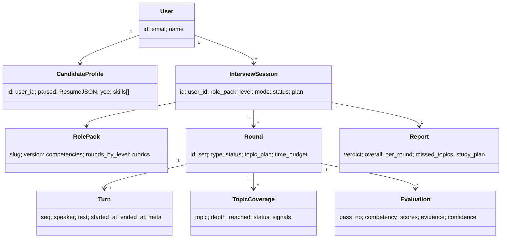
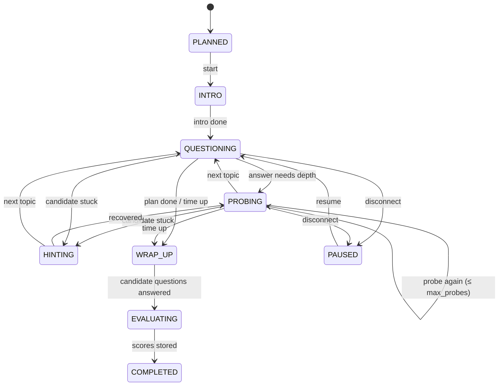

# 03 — Low-Level Design

## Domain model


## Enums
```python
class SessionStatus(StrEnum): PLANNED, LIVE, PAUSED, EVALUATING, COMPLETED, ABANDONED
class RoundStatus(StrEnum):   PLANNED, INTRO, QUESTIONING, PROBING, HINTING, WRAP_UP, EVALUATING, COMPLETED, SKIPPED
class RoundType(StrEnum):     FUNDAMENTALS, DSA, LANGUAGE_DEPTH, LLD, HLD, PROJECT_DEEP_DIVE, BEHAVIORAL, LEADERSHIP, TESTING_STRATEGY
class Level(StrEnum):         FRESHER, L1, L2, L3_SENIOR, L4_STAFF, EM, DIRECTOR
class NextAction(StrEnum):    PROBE, HINT, TWIST, NEXT_TOPIC, END_ROUND, CLARIFY, REDIRECT
```

## Round state machine

Transitions are validated in code (`RoundStateMachine.transition(event)`); the LLM can only *request* an action.

## Key classes (Python, simplified)

### Orchestrator layer
```python
class InterviewPlanner:
    def build_plan(self, profile: CandidateProfile, pack: RolePack, level: Level,
                   weak_topics: list[str]) -> SessionPlan: ...

class SessionService:
    def create(self, cmd: CreateSession) -> InterviewSession: ...
    def start(self, session_id) -> StartInfo: ...           # returns LiveKit token in voice mode
    def handle_candidate_turn(self, session_id, turn: CandidateTurn) -> AsyncIterator[str]: ...
    def pause(self, session_id) -> None: ...
    def resume(self, session_id) -> ResumeInfo: ...
```

### Round strategies (Strategy pattern)
```python
class RoundStrategy(Protocol):
    type: RoundType
    def intro(self, ctx: RoundContext) -> str: ...
    def build_prompt(self, ctx: RoundContext) -> PromptBundle: ...
    def rules(self) -> RoundRules: ...                       # max_probes, max_hints, time budget
    def ui_hints(self, ctx) -> list[UiEvent]: ...            # e.g. open_editor for DSA

class DSARound(RoundStrategy): ...
class LLDRound(RoundStrategy): ...
class HLDRound(RoundStrategy): ...
class BehavioralRound(RoundStrategy): ...                    # STAR-based probing
class ProjectDeepDiveRound(RoundStrategy): ...               # resume-claim verification
```

### Factory
```python
class RoundFactory:
    _registry: dict[RoundType, type[RoundStrategy]]
    def create(self, spec: RoundSpec, pack: RolePack) -> RoundStrategy: ...
```

### Turn controller (heart of the system)
```python
class TurnController:
    def __init__(self, llm: LLMClient, rules_engine: RulesEngine, coverage: CoverageTracker): ...

    async def next_turn(self, ctx: RoundContext, answer: CandidateTurn) -> AsyncIterator[str]:
        decision_stream = self.llm.stream_json(ctx.strategy.build_prompt(ctx), TurnDecision)
        decision = await decision_stream.header()            # action fields arrive first
        decision = self.rules_engine.enforce(ctx, decision)  # may override action
        ctx.state_machine.transition(decision.next_action)
        async for chunk in decision_stream.utterance(override=decision):
            yield chunk
        asyncio.create_task(self.coverage.analyze_async(ctx, answer))
```

### Rules engine (deterministic guardrails)
```python
class RulesEngine:
    def enforce(self, ctx: RoundContext, d: TurnDecision) -> TurnDecision:
        if ctx.elapsed >= ctx.rules.time_budget:              return d.force(NextAction.END_ROUND)
        if d.next_action == PROBE and ctx.topic.probes >= ctx.rules.max_probes:
                                                              return d.force(NextAction.NEXT_TOPIC)
        if d.next_action == HINT and ctx.topic.hints >= ctx.rules.max_hints:
                                                              return d.force(NextAction.NEXT_TOPIC)
        if ctx.remaining_topics == 0 and d.next_action == NEXT_TOPIC:
                                                              return d.force(NextAction.END_ROUND)
        return d
```

### Other services
| Class | Responsibility |
|-------|----------------|
| `CoverageTracker` | Updates `TopicCoverage` (depth reached, gaps) from async analyzer output |
| `CheckpointStore` | Save/load `RoundContext` in Redis after every turn |
| `SessionLease` | Redis `SET NX PX` lease so only one worker drives a session |
| `EventPublisher` | Publishes `RoundCompleted`, `SessionCompleted` to Redis Streams |
| `ResumeParser` | Text extraction + LLM structured extraction + validation |
| `QuestionRetriever` | pgvector search for seed questions by topic/level/resume similarity |
| `CodeRunner` | Wraps Judge0; enforces language whitelist and resource limits |

## Design patterns used
| Pattern | Where | Benefit |
|---------|-------|---------|
| Strategy | Round types | Add new round type without touching controller |
| Factory | `RoundFactory` from role pack | Config-driven rounds for any field |
| State | Round state machine | Illegal transitions impossible |
| Observer / events | Round/session completion | Eval, analytics, notifications decoupled |
| Repository | DB access | Domain testable without Postgres |
| Adapter | `LLMClient`, `STTClient`, `TTSClient` | Swap providers without code changes |
| Template method | `RoundStrategy.build_prompt` common skeleton | Consistent prompts across rounds |
